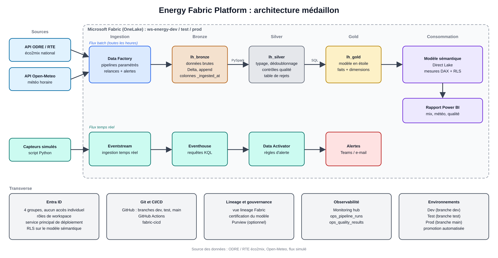

# Energy Fabric Platform

Plateforme data de bout en bout sur **Microsoft Fabric** : production et consommation électrique en France (RTE éco2mix), météo (Open-Meteo) et flux temps réel simulé.

## 🏗️ Architecture globale de la plateforme



```
Sources (API ODRE/RTE, Open-Meteo, capteurs simulés)
   ├─ Batch : Data Factory pipelines ─┐
   └─ Temps réel : Eventstream ───────┤
                                      ▼
   Lakehouse BRONZE (brut, Delta)
                                      ▼  notebooks PySpark
   Lakehouse SILVER (typé, dédupliqué, qualité, rejets)
                                      ▼
   GOLD (modèle en étoile)
                                      ▼
   Modèle sémantique Direct Lake → Power BI
   Transverse : Entra ID · Git/CI-CD · Lineage · Monitoring · Alertes
```

## Environnements

| Env | Workspace | Branche Git |
|---|---|---|
| Dev | `ws-energy-dev` | `dev` |
| Test | `ws-energy-test` | `test` |
| Prod | `ws-energy-prod` | `main` |

## Feuille de route

Voir [ROADMAP.md](ROADMAP.md). Chaque dossier `weekNN_*` contient les fichiers à produire et à lire pour la semaine.

## Stack

Fabric (Lakehouse, Data Factory, Eventstream, Eventhouse, Data Activator, Power BI Direct Lake), PySpark, SQL, KQL, Entra ID, GitHub Actions, `fabric-cicd`.

## Résultats attendus (à compléter en semaine 10)

- Schéma final, captures du rapport Power BI, de la lineage et du Monitoring hub
- Lien vers la vidéo de démo
- Choix techniques et limites
